# 图像提示词学习词典

**Image Prompt Notebook · 收集灵感，验证写法，记录成长。**

一本持续更新的 AI 图像生成学习笔记。收录有明确出处的提示词，结合实际生成结果，拆解构图、色彩与材质，并整理可复用模板。

[浏览词条](entries/README.md) · [分类规则](categories/README.md) · [词条模板](templates/entry-template.md) · [学习笔记](notes/README.md) · [来源与使用说明](ATTRIBUTION.md)

---

## 按类别浏览

| 主分类 | 当前词条 |
| --- | --- |
| 海报与平面设计 | [浏览本类词条](entries/README.md#海报与平面设计)：古诗词、等高线地形与细线设色模板 |
| 插画与人物绘画 | [浏览本类词条](entries/README.md#插画与人物绘画)：木刻、蜡笔、连环画、重彩等 |
| 人物摄影 | [浏览本类词条](entries/README.md#人物摄影)：眼神互动、手机连拍、CCD 人像、超写实自拍、韩系直闪、复古 DV 与古典肖像等 |
| 风景与城市日常 | [004 · 生活中未曾注意的美](entries/004-unnoticed-everyday-beauty/README.md) / [006 · 百年后的地标](entries/006-landmarks-after-humans/README.md) |
| 产品与商业视觉 | [007 · 产品包装转译成衣](entries/007-packaging-fashion/README.md) |

每条一个主分类，风格、题材与情绪另作标签。[查看完整分类索引](entries/README.md)。

## 海报与平面设计

### [001 · 新中式古诗词海报](entries/001-chinese-poetry/README.md)

以辛弃疾《破阵子·掷地刘郎玉斗》为主题，探索蓝色设色、中文排版与诗意场景。

`东方美学` `装饰插画` `海报排版` · **个人实验 / 已测试一次**

提示词来源：**X 作者 Larus Canus**；图片为本项目生成实验。原帖链接待补充。

### [015 · 山河流线 · 等高线艺术海报](entries/015-flowing-topographic-poster/README.md)

<a href="entries/015-flowing-topographic-poster/README.md">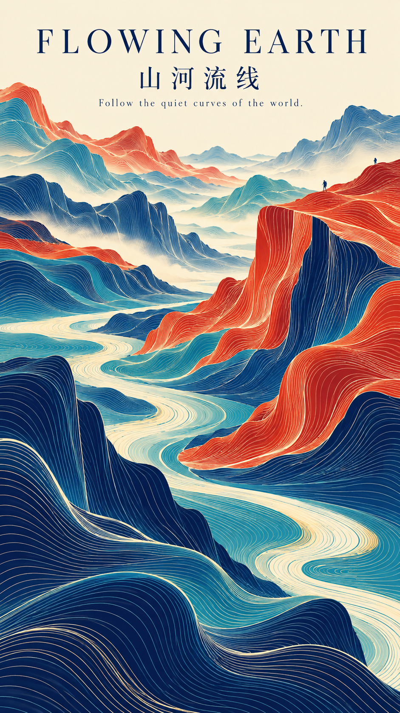</a>

英文模板完整在上、中文模板完整在下；保存海报示例，并补充无字正文插画与封面底图的用途建议。

`连续等高线` `抽象山水` `书籍用途` · **海报已生成 / 书籍版本待测试**

提示词来源：**X 作者 [Larus Canus（@MrLarus）](https://x.com/MrLarus)**，署名与账号由整理者确认；原帖待补。图片为本项目生成。

### [016 · 新中式古诗词 · 细线设色通用模板](entries/016-classical-poetry-color-template/README.md)

<a href="entries/016-classical-poetry-color-template/README.md">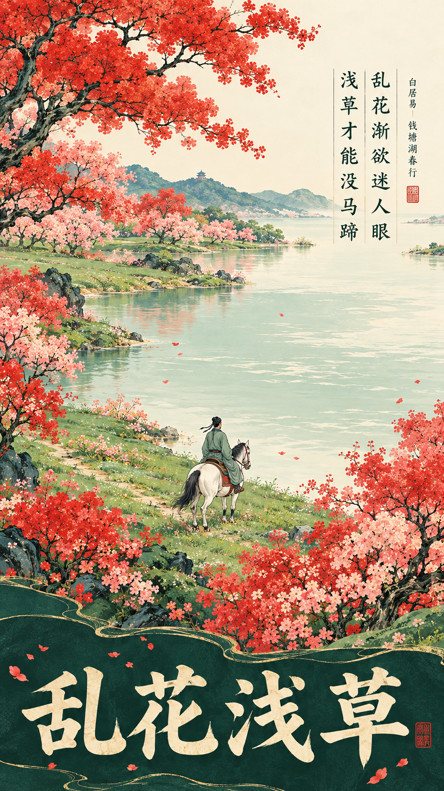</a>

保存完整原始模板、简要填写与配色方法；附《乱花浅草》示例及无字插画的改用说明。

`古诗词` `东方设色` `书籍插画` · **示例已生成一次**

提示词来源：**X 作者 [Larus Canus（@MrLarus）](https://x.com/MrLarus)**，由整理者确认；原帖待补。图片为本项目生成。

## 插画与人物绘画

<a href="entries/002-ouyang-feng/README.md">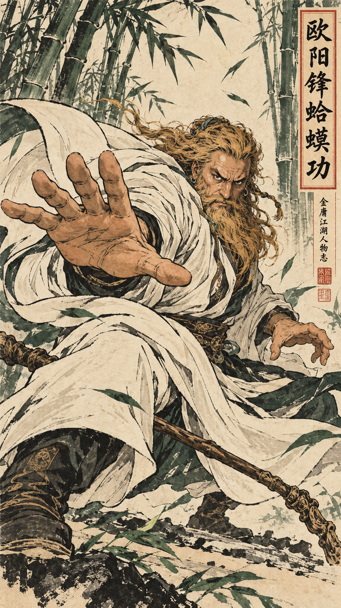</a>

### [002 · 欧阳锋蛤蟆功 · 武侠浮世绘](entries/002-ouyang-feng/README.md)

探索强透视掌势、白袍曲线与竹林背景，记录多色木版风格的动作和材质表现。

`东方美学` `武侠人物` `木版插画` · **个人实验 / 已测试一次**

提示词来源：**X 作者 Larus Canus**；图片为本项目生成实验。原帖链接待补充。

<a href="entries/005-textbook-ballpoint-doodle/README.md">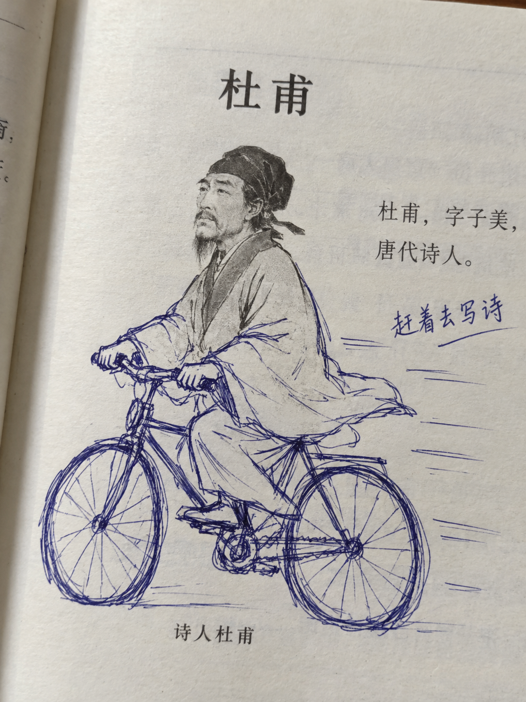</a>

### [005 · 课本圆珠笔二次涂鸦](entries/005-textbook-ballpoint-doodle/README.md)

“杜甫很忙”式蓝黑圆珠笔加画：可指定动作、道具与同框角色。本次为模拟教材页，保留文字错误与改进记录。

`圆珠笔` `教材涂鸦` `业余手绘` · **个人实验 / 已测试一次**

提示词来源：**X 作者 [DeepBlue深蓝（@DeepBlueX0）](https://x.com/DeepBlueX0)**；图片为本项目生成实验。原帖链接待补充。

### [009 · 极简黑白木刻人物](entries/009-minimal-black-white-woodcut/README.md)

<a href="entries/009-minimal-black-white-woodcut/README.md">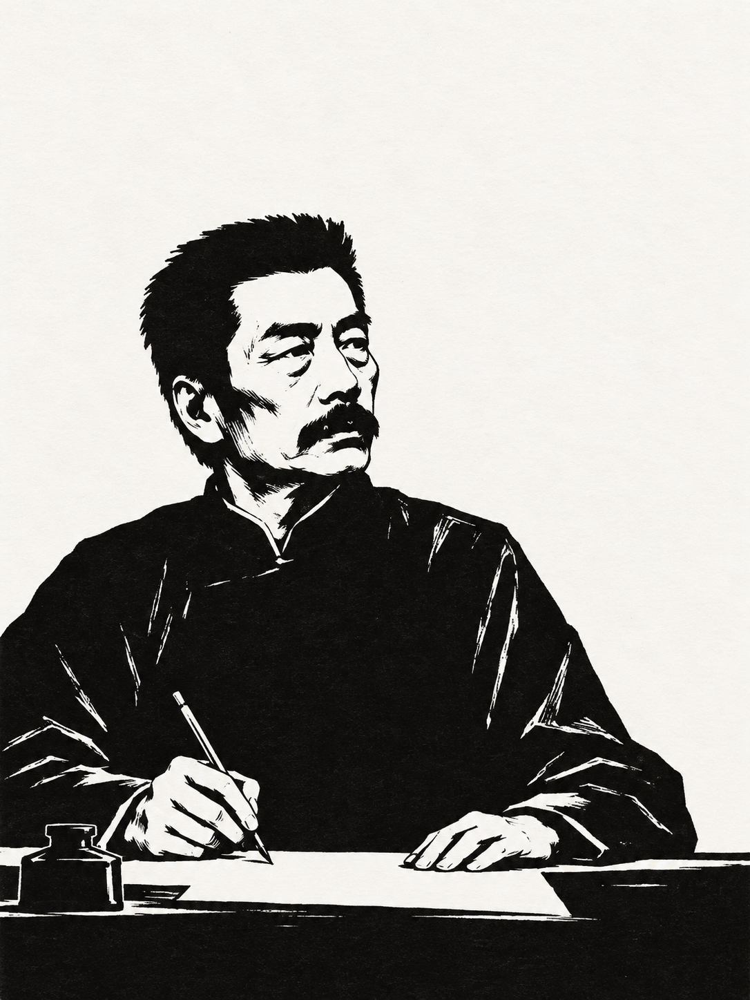</a>

保存黛玉葬花与鲁迅执笔两张示例，补充书籍、公众号用途与留白、刀痕和缩小可读性的观察。

`黑白木刻` `文学人物` `书籍插图` · **两个主题各生成一次**

提示词来源：**X 作者 [DeepBlue深蓝（@DeepBlueX0）](https://x.com/DeepBlueX0)**；图片为本项目生成。原帖待补。

### [010 · 跨作品人物 · 怀旧小人书](entries/010-crossover-lianhuanhua/README.md)

<a href="entries/010-crossover-lianhuanhua/README.md">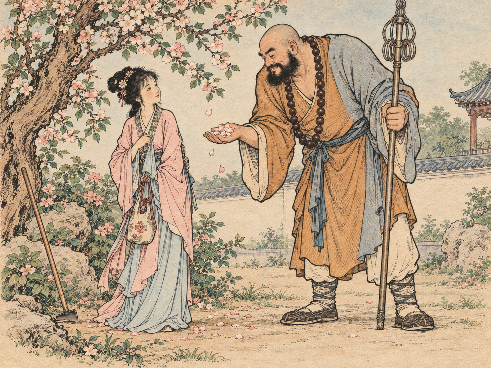</a>

保存线描和淡彩两版，可替换跨度更大的角色组合；附插画与小人书封皮的待测试模板。

`连环画` `淡彩印刷` `跨作品人物` · **线描生成 / 淡彩编辑**

提示词来源：**X 作者 [DeepBlue深蓝（@DeepBlueX0）](https://x.com/DeepBlueX0)**；图片为本项目生成。原帖待补。

### [011 · 稚拙蜡笔画 · 自由想象](entries/011-naive-crayon-imagination/README.md)

以熟悉角色和一个简单奇想建立童趣，记录蜡笔笔触、纸纹与留白的实际表现。

`蜡笔` `自由想象` `留白` · **已生成一次**

提示词来源：**X 作者 [DeepBlue深蓝（@DeepBlueX0）](https://x.com/DeepBlueX0)**；图片为本项目生成。原帖待补。

### [012 · 敦煌飞天 · 现代重彩重绘](entries/012-dunhuang-flying-apsara/README.md)

<a href="entries/012-dunhuang-flying-apsara/README.md">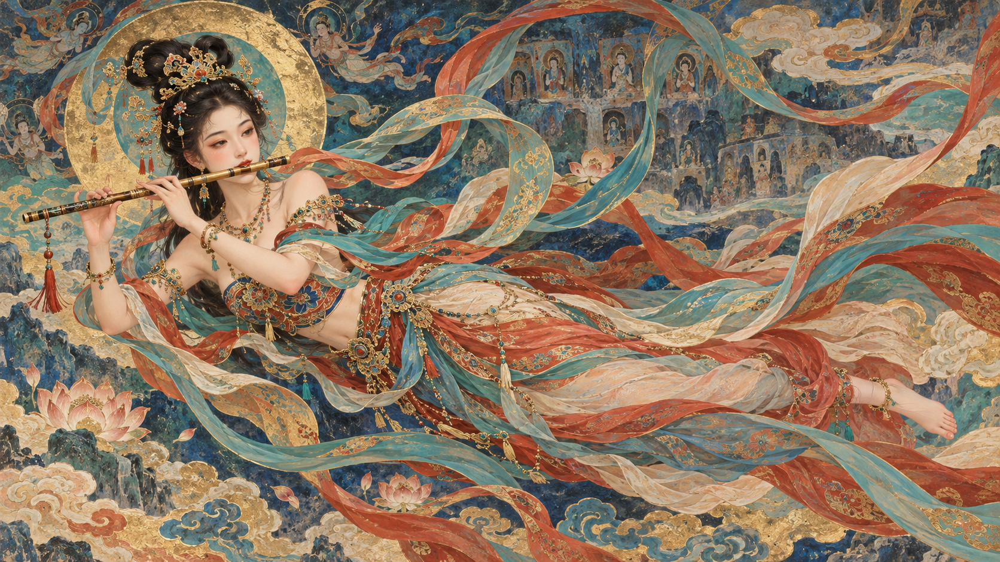</a>

现代真人面容与工笔重彩融合，记录背景密度、飘带路径与壁画质感的实际表现。

`敦煌美学` `工笔重彩` `半写实` · **已生成一次**

提示词来源：**X 作者 [鱼哥（@MrgAfish）](https://x.com/MrgAfish)**；图片为本项目生成。原帖待补。

### [017 · 嫦娥 · 工笔细线寓意插画](entries/017-change-symbolic-fine-line/README.md)

<a href="entries/017-change-symbolic-fine-line/README.md">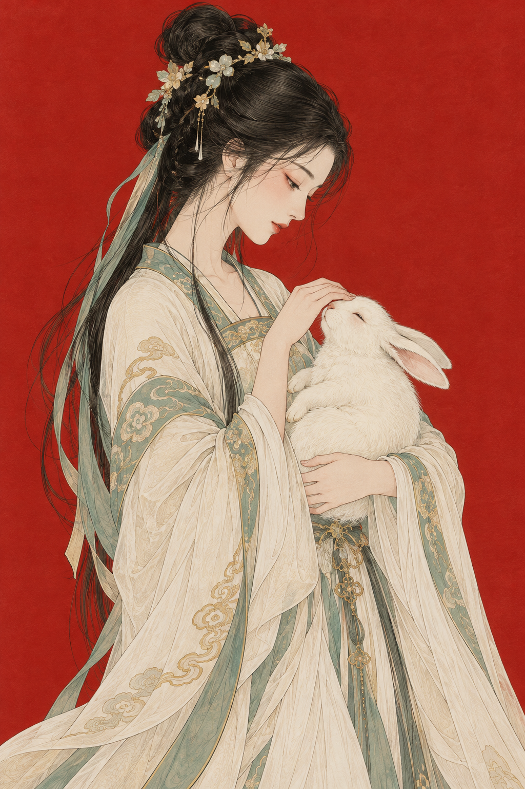</a>

以一个明确的象征性动作建立叙事，保存原文、实际提交与细线、色场和装饰密度观察。

`工笔细线` `东方寓意` `朱砂色场` · **已生成一次**

提示词作者与原帖由整理者后续补充；图片为本项目生成。

## 人物摄影

<a href="entries/003-galaxy-saving-gaze/README.md">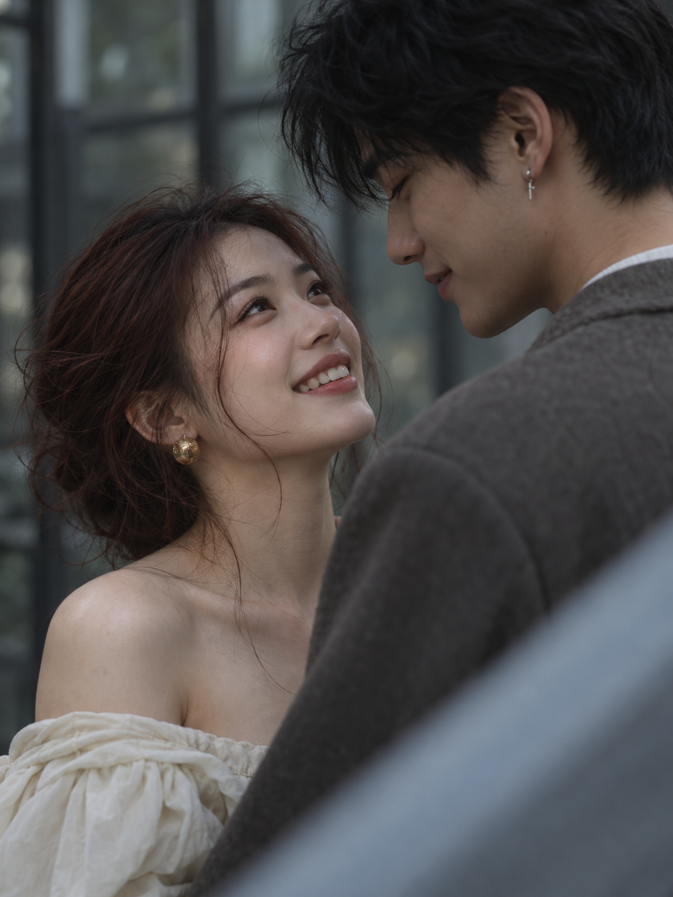</a>

### [003 · 拯救银河系的眼神](entries/003-galaxy-saving-gaze/README.md)

用低饱和冷灰绿、柔亮肤面与景深层次，记录仰望眼神与自然笑容；附模型适配心得及待验证写法。

`摄影人像` `双人近景` `眼神互动` · **个人实验 / 已测试一次**

提示词来源：**X 作者 [lyshen（@lishishen7i）](https://x.com/lishishen7i)**；图片为本项目生成实验。原帖链接待补充。

<a href="entries/008-falling-phone-burst/README.md">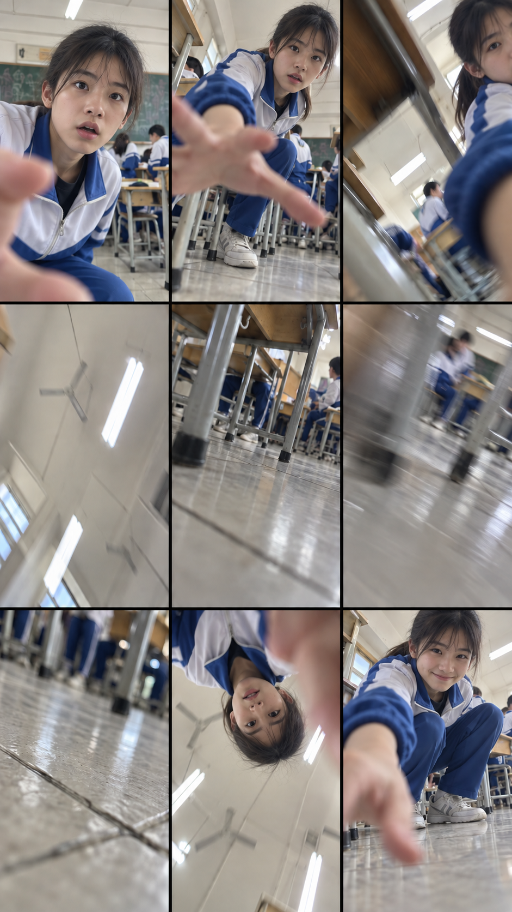</a>

### [008 · 手机坠落九连拍](entries/008-falling-phone-burst/README.md)

以中国女高中生和教室为最终主题，模拟后置镜头滑落到拾取的九帧过程，记录连续性、时间范围与模糊控制的不足。

`手机POV` `九宫格` `连续动作` · **最终版为参考图编辑结果**

提示词来源：**X 作者 [DeepBlue深蓝（@DeepBlueX0）](https://x.com/DeepBlueX0)**；图片为本项目生成。原帖待补。

### [013 · 韩系自然人像 · CCD 彩色柔焦](entries/013-korean-ccd-portrait/README.md)

<a href="entries/013-korean-ccd-portrait/README.md">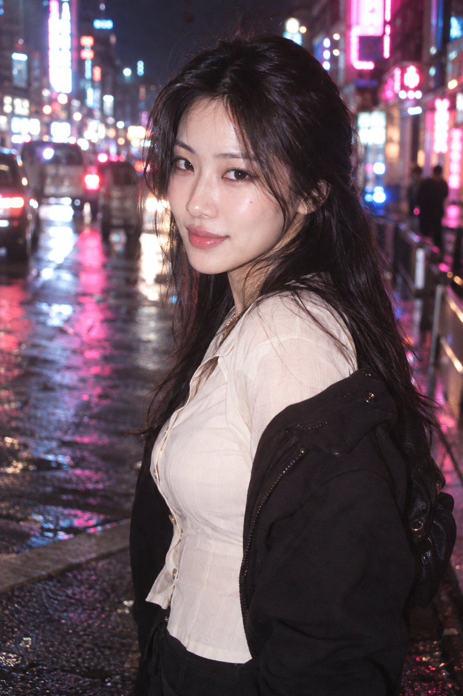</a>

保存原始短提示词与实际改写，补充目标明确时短提示词的价值；本次未进行长短对照。

`CCD质感` `彩色柔焦` `狐系眼神` · **原文未直接测试 / 改写生成一张**

提示词来源：**X 作者 尘林 Spark**，署名由整理者提供；账号与原帖待补。图片为本项目生成。

### [014 · 男友衬衫 · iPhone 失败四连拍](entries/014-oversized-shirt-phone-burst/README.md)

<a href="entries/014-oversized-shirt-phone-burst/README.md">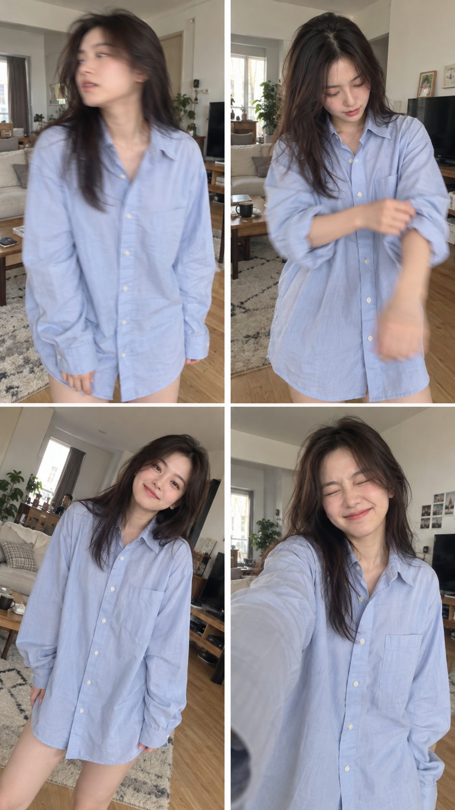</a>

保存宽松男款衬衫的四格随拍，记录布料垂坠、服装遮挡与抓拍瑕疵；整理者认可本次效果。

`Oversized` `居家随拍` `四连拍` · **改写生成一次**

提示词来源：**X 作者 [DeepBlue深蓝（@DeepBlueX0）](https://x.com/DeepBlueX0)**，署名由整理者确认；原帖待补。图片为本项目生成。

### [018 · 真实人物 · 超写实编辑自拍](entries/018-missdelulu9-realistic-portrait/README.md)

短标签 **真实人物**。保存英文超写实母版、一则雨夜便利店填写示例，以及一则地铁站台街拍原文。本项目尚未生成。

`超写实` `编辑自拍` `竖版` · **未测试 / 无效果图**

风格来源：**X 作者 [Eesha（@MissDelulu9）](https://x.com/MissDelulu9)**。雨夜示例仍是蒸馏；地铁站台一则按原帖照录。授权未确认。

### [019 · Eli Ha韩式 · CCD 直闪抓拍](entries/019-fromsummerf-eli-ha-korean-ccd/README.md)

短标签 **Eli Ha韩式**。保存中文直闪母版、车厢夜景与贴脸方图等蒸馏，以及一则极低机位自拍原文。湿润男性电影特写另见 [037](entries/037-fromsummerf-wet-male-closeup/README.md)，不使用本标签。尚未生成。

`CCD直闪` `韩系女友视角` `妆面光` · **未测试 / 无效果图**

风格来源：**X 作者 [Eli Ha（@FromSummerF）](https://x.com/FromSummerF)**，账号由整理者提供，主页未独立核验。授权未确认。

### [020 · 复古 DV 继母裙少女肖像](entries/020-vintage-dv-stepmother-portrait/README.md)

整理者自用的中文提示词，原样保存。指向 GPT Image 2.5，本项目尚未生成。不并入 018、019。

`复古DV` `室内棚拍` `侧脸回眸` · **未测试 / 无效果图**

提示词来源：整理者自用，无原帖。

### [021 · 象牙白纱 · 古典电影肖像](entries/021-ivory-veil-classical-portrait/README.md)

短标签 **梦老湿古典**。深黑背景、象牙白纱与丝绸、伦勃朗柔侧光、85mm。原文照录，指向 GPT Image 2.5，尚未生成。不并入其他短标签。

`古典电影` `象牙白纱` `85mm` · **未测试 / 无效果图**

提示词来源：**X 作者 [梦老湿 Dream AI（@jackzhang123vip）](https://x.com/jackzhang123vip)**，[原帖](https://x.com/jackzhang123vip/status/2114694643510395284)由整理者提供。授权未确认。同一短标签的杏橘鲜花见[036](entries/036-apricot-orange-flower-portrait/README.md)。

### [027–035 · Cyber日系](entries/README.md#人物摄影)

短标签 **Cyber日系**。九条日文【画像生成プロンプト】原文照录，接在[026 · 淡粉针织](entries/026-cybertotal-pale-pink-knit/README.md)之后。九条都不是 026 那一帖。尚未生成。

`Cyber日系` · **未测试 / 无效果图**

提示词来源：**X 作者 [Prompt アトリエ（@CyberTotal2026）](https://x.com/CyberTotal2026)**。授权未确认。

### [036 · 杏橘鲜花 · 古典时装肖像](entries/036-apricot-orange-flower-portrait/README.md)

短标签 **梦老湿古典**。与 021 同标签：这一则是杏橘鲜花、灰褐哑光墙和窗光，85mm、9:16。原文照录，尚未生成。

`杏橘鲜花` `窗光` `85mm` · **未测试 / 无效果图**

提示词来源：**X 作者 [梦老湿 Dream AI（@jackzhang123vip）](https://x.com/jackzhang123vip)**，[原帖](https://x.com/jackzhang123vip/status/2114884788477681864)。授权未确认。

### [037 · 湿润男性 · 电影特写](entries/037-fromsummerf-wet-male-closeup/README.md)

湿皮肤、单眼与暖橙金色高光。原文照录。不归入「Eli Ha韩式」，也不新开短标签。尚未生成。

`电影特写` `湿润皮肤` · **未测试 / 无效果图**

提示词来源：**X 作者 [Eli Ha（@FromSummerF）](https://x.com/FromSummerF)**，[原帖](https://x.com/FromSummerF/status/2115242070868894012)。授权未确认。

### [038 · 古寺跪拜祈福全身](entries/038-temple-kneel-prayer-portrait/README.md)

整理者自用的中文提示词，原样保存。2:3 竖幅，古寺殿前跪拜合十的全身中全景。本项目尚未生成。不并入 018、019，也不新开短标签。

`古寺祈福` `全身跪姿` `晴日高调` · **未测试 / 无效果图**

提示词来源：用户提供 / 整理者自用，无原帖。授权自有。

### [039 · 夏日窗边微汗手机抓拍](entries/039-summer-window-sweat-phone-snap/README.md)

整理者自用的中文提示词，原样保存。9:16 竖版，室内窗边的手机抓拍，出汗只写到极轻微。本项目尚未生成。不新开短标签。

`手机抓拍` `夏日微汗` `窗边` · **未测试 / 无效果图**

提示词来源：用户提供 / 整理者自用，无原帖。授权自有。

## 风景与城市日常

<a href="entries/004-unnoticed-everyday-beauty/README.md">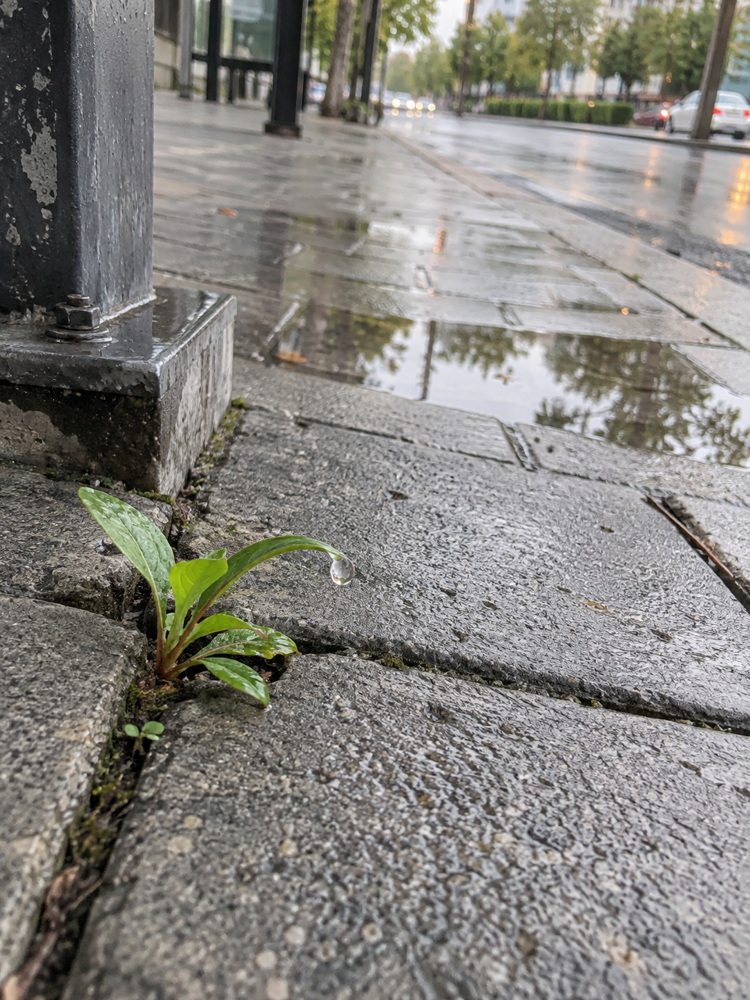</a>

### [004 · 生活中未曾注意的美](entries/004-unnoticed-everyday-beauty/README.md)

在日常城市环境中发现自然的细微互动。小草是一个示例，也可尝试雨滴、落叶、光影、小鸟与水面倒影等场景。

`手机随拍` `城市自然` `治愈` · **个人实验 / 已测试一次**

提示词来源：**X 作者 [DeepBlue深蓝（@DeepBlueX0）](https://x.com/DeepBlueX0)**；图片为本项目生成实验。原帖链接待补充。

### [006 · 百年后的地标 · 野生动物视角](entries/006-landmarks-after-humans/README.md)

<a href="entries/006-landmarks-after-humans/README.md">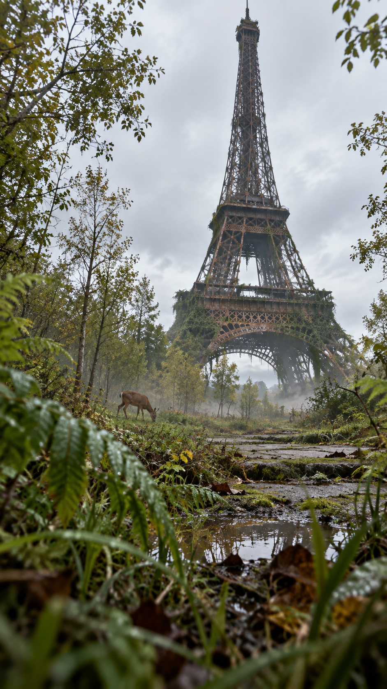</a>

同一主题可选择 **iPhone 随拍**或**过期 35mm 彩色胶片**，并调整地标、动物机位与自然演变细节。

`架空未来` `野生动物POV` `手机或胶片` · **两个版本各生成一次，非严格对照实验**

提示词来源：**X 作者 [DeepBlue深蓝（@DeepBlueX0）](https://x.com/DeepBlueX0)**；两图均为本项目生成。原帖待补充。

## 产品与商业视觉

### [007 · 产品包装转译成衣 · Lookbook 与无模特展示](entries/007-packaging-fashion/README.md)

收录可口可乐与大白兔主题实验，保留设计不足的观察；增加无模特隐形人台展示与更明确的设计转译模板。

`服装概念` `配饰` `包装转译` · **有模特已生成 / 无模特待测试**

提示词来源：**X 作者 [DeepBlue深蓝（@DeepBlueX0）](https://x.com/DeepBlueX0)**；图片为本项目非官方设计概念。原帖待补。

## 如何使用

1. 从效果图与分类选择词条。
2. 阅读来源、测试条件及局限，再复制提示词。
3. 替换模板中的主题变量，保存自己的结果与修改记录。
4. 整理者已经命名的创作者短标签，集中记在[风格短标签对照](notes/style-tags.md)，不在各词条另起一份目录。

生成结果会受模型、版本与上下文影响。本词典记录观察，不保证同一提示词每次得到相同效果。

## 更新记录

| 日期 | 更新 |
| --- | --- |
| 2026-10-28 | 收录两则用户提供的整理者自用提示词（038 古寺跪拜祈福全身、039 夏日窗边微汗手机抓拍），归人物摄影；原文照录，授权自有，无原帖，状态未测试，无效果图，不新开短标签。 |
| 2026-10-28 | 收录 Cyber日系九则（027–035，原文照录，与 026 淡粉针织不是同一帖）；018 补地铁站台街拍原文；019 补极低机位自拍原文；036 为梦老湿古典的杏橘鲜花；037 为湿润男性电影特写，不归入 Eli Ha韩式。授权未确认，无效果图。 |
| 2026-10-27 | 增加短标签「梦老湿古典」，收录象牙白纱古典电影肖像（021）；原文照录，授权未确认，无效果图。 |
| 2026-10-27 | 增加短标签「SI写实」（@xyue13，022–023）与「Leo电影感」（@listudio，024–025）；原文照录，授权未确认，无效果图。 |
| 2026-10-27 | 词条019补 Eli Ha 两则风格蒸馏（美术馆冷白日景、室内沙发直闪）及妆面纠偏笔记，附原帖链接；授权未确认，无新图。 |
| 2026-10-25 | 收录整理者自用的复古 DV 继母裙肖像提示词（020），归人物摄影；原文照录，状态未测试，无效果图。 |
| 2026-10-24 | 增加风格短标签对照；收录「真实人物」与「Eli Ha韩式」两则人物摄影蒸馏（018、019），状态未测试，无效果图。 |
| 2026-10-13 | 保存嫦娥工笔寓意插画及抚兔示例，归插画类，作者待补；古诗词原始模板与配色用法已收录于016。 |
| 2026-10-13 | 保存Larus Canus的古诗词细线设色原始模板，附乱花浅草示例、配色与插画用法。 |
| 2026-10-13 | 收录山河流线等高线海报，中英文按上下完整分区；补充书籍插画与封面用途、留白与线条密度建议。 |
| 2026-10-13 | 收录DeepBlue深蓝的男友衬衫失败四连拍，归人物摄影；保存图片与提交文本，补充服装结构、抓拍瑕疵和连续性观察。 |
| 2026-10-13 | 收录尘林 Spark 的韩系 CCD 短提示词与改写结果，归人物摄影；补充短提示词经验及对照测试边界。 |
| 2026-10-13 | 收录鱼哥的敦煌飞天重绘，补充背景简化、飘带路径与人物融合观察。 |
| 2026-10-12 | 收录稚拙蜡笔画及加菲猫示例，补充笔触、纸纹、角色识别与留白建议。 |
| 2026-10-12 | 收录跨作品人物小人书，保存林黛玉与鲁智深两版；补充大跨度角色与封皮模板。 |
| 2026-10-12 | 收录极简黑白木刻人物，保存黛玉与鲁迅示例，补充书籍和公众号插图应用观察。 |
| 2026-10-12 | 收录手机坠落九连拍女高中生版，归人物摄影，补充轨迹、时间范围与实际体验。 |
| 2026-10-12 | 收录包装转译成衣案例及5张结果；补充无模特展示模板，区分设计选择与未验证的模型推断。 |
| 2026-10-12 | 收录百年地标的 iPhone 与过期 35mm 胶片两个版本及图片，补充动物 POV 与场景调整方法。 |
| 2026-10-12 | 收录课本圆珠笔二次涂鸦，归入插画类；补充动作、图案和动漫同框模板，记录模拟页文字错误。 |
| 2026-10-12 | 收录“生活中未曾注意的美”，标注 DeepBlue深蓝 来源；整理主分类与标签，首页按海报、插画、人物摄影、风景分区。 |
| 2026-10-12 | 收录“拯救银河系的眼神”，标注 lyshen 来源；加入美学与细节约束的模型适配学习笔记。 |
| 2026-10-11 | 加入欧阳锋蛤蟆功武侠浮世绘案例，标注 Larus Canus 来源并记录动作与材质表现。 |
| 2026-10-11 | 建立词典结构、来源说明与统一模板；加入首个古诗词海报实验。 |

## 关于这个项目

由 [dayuanzi111](https://github.com/dayuanzi111) 整理，AI 协助编辑。第三方提示词、个人改写与生成实验分别标注。结构参考 [awesome-gpt-image-2](https://github.com/freestylefly/awesome-gpt-image-2)，本项目独立整理内容。

提交建议请使用 [Issues](https://github.com/dayuanzi111/image-prompt-notebook/issues)。收录前请提供原作者、原帖链接与可公开使用的材料。
