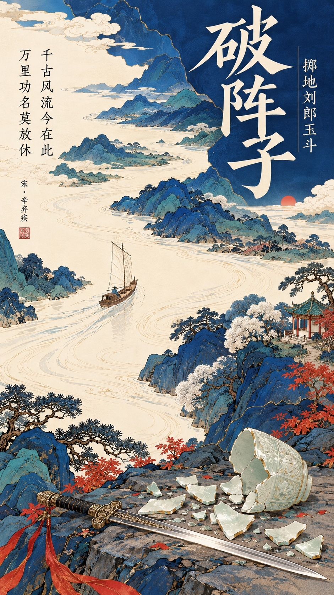

# 001 · 新中式古诗词海报

[返回索引](../README.md) · [返回首页](../../README.md)

> 用蓝色设色与诗词排版，将古典意象转化为一张竖幅海报。

## 基本信息

| 字段 | 内容 |
| --- | --- |
| 分类 | 东方美学 / 装饰插画 / 海报排版 |
| 来源类型 | 第三方提示词收藏与本项目生成实验 |
| 初始提示词作者 | Larus Canus（X 作者，由整理者提供署名） |
| 原帖链接 | 待补充，尚未确认账号链接 |
| 效果图 | 本项目生成结果，非外部作者作品 |
| 工具 | Codex 内置图像生成工具，具体底层模型未确认 |
| 测试日期 / 次数 | 2026-10-11 / 1 次 |
| 比例 | 9:16，输出 941 × 1672 像素 |
| 状态 | 已测试，风格仍待改进 |

## 效果图



## 初始提示词

提示词来源：**X 作者 Larus Canus**。署名由本项目整理者提供，原帖与账号链接待补充。以下为整理者提供的收录文本，换行做了整理；与原帖的逐字一致性尚未核对。后续 AI 改写、生成图片与实验笔记属于本项目实验，不代表原作者作品。

```text
【古诗词】宋代辛弃疾的破阵子·掷地刘郎玉斗千古风流今在此，万里功名莫放休
【核心意象】由你来填写
【主色调】蓝色和与蓝色相搭配的颜色
【情绪氛围】你来填写
【画幅比例】9:16

根据古诗词创作一张新中式细线设色装饰插画海报，将诗中的景物、空间与情感转化为完整的东方诗意场景。

采用高位俯瞰、东方散点透视与现代平面构成。树冠呈柔软蓬松的云团状色块，具有细腻粉末点染质感，内部穿插纤细连续的墨黑枝条。传统建筑使用精细工笔线描、规整青绿瓦片、白墙朱柱。地面与水面采用大面积暖米白留白，搭配少量不规则墨黑阴影。

配色采用饱满、干净、哑光的东方传统色系，以主色形成视觉重量，辅以石青、石绿、朱砂、赭红等颜色，保持细腻统一的纸本装饰插画质感。

画面突出核心意象，通过自然曲线、色块包围和疏密对比建立视觉层次。构图随诗词内容变化，不强行加入无关建筑或树木。

融入大幅暖白色中文标题、小型纵排诗句、作者署名与少量朱印，形成完整的古诗词艺术海报。

避免写实山水、厚重水墨、3D、油画、动漫风、复杂远景、过度颗粒及人工做旧。保持教科书级的精细线条、柔和设色与东方装饰美学。
```

## 我的理解

- 核心意象：碎玉与古剑表现决断，白帆扁舟与江流表现远行；两者是这次改写选择的视觉解释。
- 情绪：豪迈昂扬、清峻辽阔。
- 配色：靛蓝、石青建立视觉重量，暖米白提供留白，朱砂点缀。
- 构图：江流引导视线，标题与前景意象形成上下呼应。
- 诗句参考：[辛弃疾《破阵子·掷地刘郎玉斗》](https://www.gushiwen.cn/shiwenv_6fb2d4a7477a.aspx)。

## 实际提交版本

以下为 AI 辅助改写后实际提交的文本。

```text
创作一张完整的新中式细线设色装饰插画古诗词艺术海报，严格竖幅9:16。主题为宋代辛弃疾《破阵子·掷地刘郎玉斗》。核心意象：前景掷地碎裂的青白玉斗与一柄细长古剑，中部白帆扁舟沿曲折江流驶向上方开阔山河，以碎玉的决断和扬帆的进取表现千古风流、万里功名。情绪豪迈昂扬、清峻辽阔，有坚定的进取力量。高位俯瞰、东方散点透视、现代平面装饰构成。主体蓝色：饱满哑光群青、靛蓝、石青色山坡与大片云团树冠形成视觉重量，搭配少量石绿、暖米白、朱砂和赭红。江流与地面为大面积暖米白留白，以优雅自然曲线贯穿全幅。右下前景青白玉斗几片明确碎玉呈精细轮廓，与古剑形成克制视觉中心；中部偏左小巧白帆木舟，帆上无文字；向上伸展的江流包围蓝色山丘和少量柔软蓬松云团状树冠，树冠内部纤细连续墨黑枝条，细腻轻微粉末点染而非粗颗粒。仅一处小型岸边传统亭台作为空间尺度，精细工笔线描、规整青绿瓦片、白墙朱柱，不加入复杂楼群。自然曲线、色块包围、疏密对比建立层次，不复杂远景、不写实山水。全画细线清楚、工整精细，柔和统一纸本装饰质感，干净无做旧。Typography is essential and must be correctly written in Chinese. 上部深蓝大色块内大幅暖白色中文标题，精美有力度的宋体书法字，准确文字“破阵子”；标题旁小字“掷地刘郎玉斗”。左侧留白处安排精细小型纵排诗句，准确文字“千古风流今在此”“万里功名莫放休”，各一列从上至下；小型作者署名“宋 · 辛弃疾”，少量朱红方印。确保标题清晰可读且无错字，不生成额外文字。不要摄影、3D、油画、动漫、厚重泼墨、复杂远景、过度颗粒、人工做旧。教科书级精细线条与新中式东方装饰美学。
```

## 实验观察

| 观察项 | v1 结果 |
| --- | --- |
| 蓝色主调与暖米白江流 | 表现明显 |
| 标题、选定诗句与署名 | 主要文字目视可辨，发布印刷前仍需校对 |
| 碎玉、剑、扁舟 | 均出现；玉器偏装饰碗形，典故器形未验证 |
| 现代平面构成 | 不充分，整体偏传统青绿山水 |
| 蓬松云团树冠 | 不充分，较多传统松树与细碎树丛 |
| 简洁远景与轻纸感 | 山峰层次及岩石纹理较密，纸纹比预期明显 |

## 可复用模板

以下为整理后的待验证模板，不是第二次实验结果。

```text
以[诗词与作者]创作9:16新中式细线设色装饰海报。
核心意象：[从诗词提取的2—3个意象]。情绪：[情绪]。
以[主色]形成大面积哑光平涂色块，辅以暖米白和[点缀色]。
采用高位俯瞰、东方散点透视与现代平面构成。
控制为三层空间，简化远景，仅保留必要景物。
如有树木，用蓬松云团状树冠与细墨线枝条；避免密集松针。
地面和水面保留大面积暖米白，减少岩石纹理与纸纹。
大幅暖白标题“[标题]”，小型纵排“[诗句]”，署名“[作者]”。
避免写实、3D、厚重水墨、复杂远景和做旧。
```

## 下一次实验

先只修改“场景复杂度”：限制山丘数量、取消细碎远山、压低岩石纹理，再检查是否更接近现代装饰插画。尚未进行重复测试。
