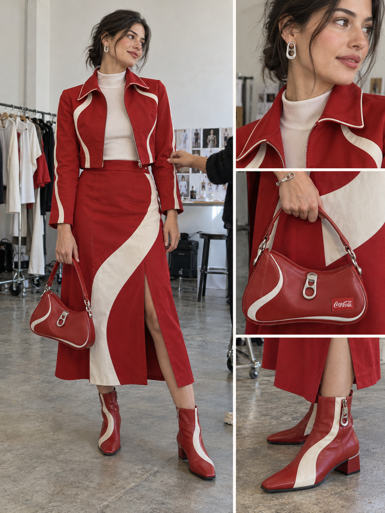
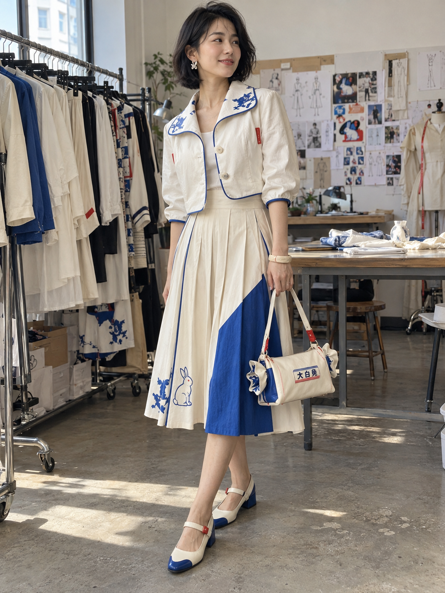
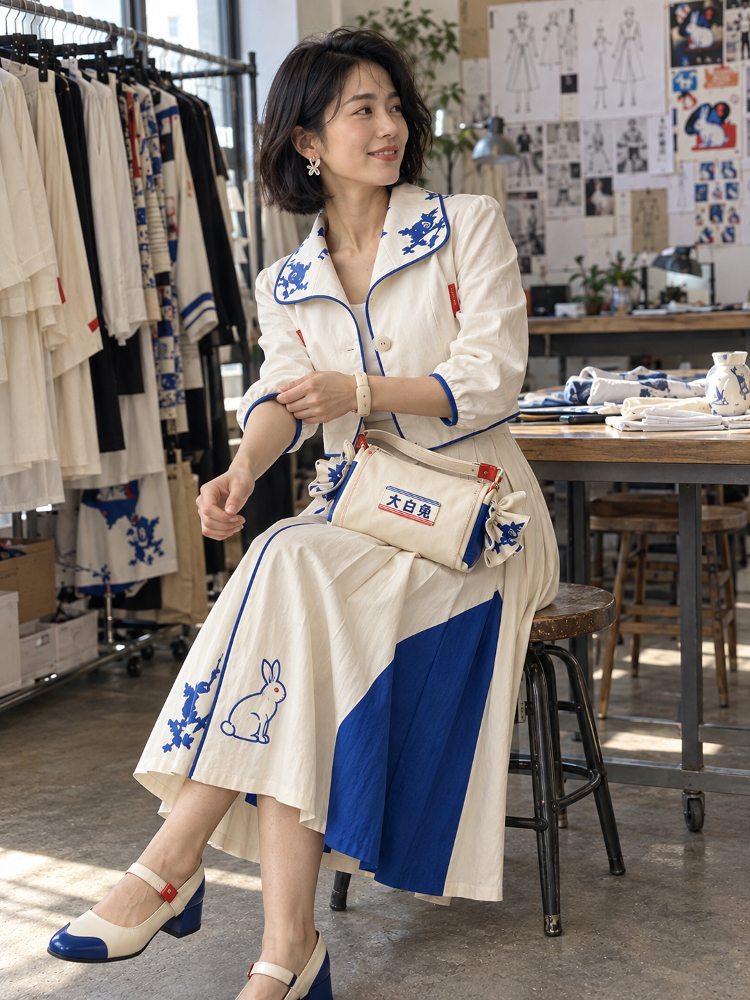
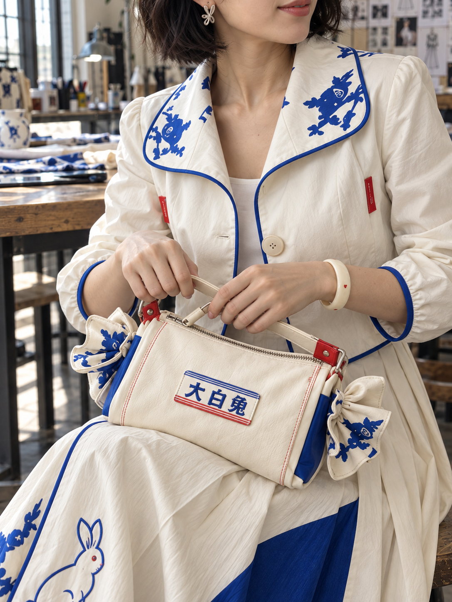
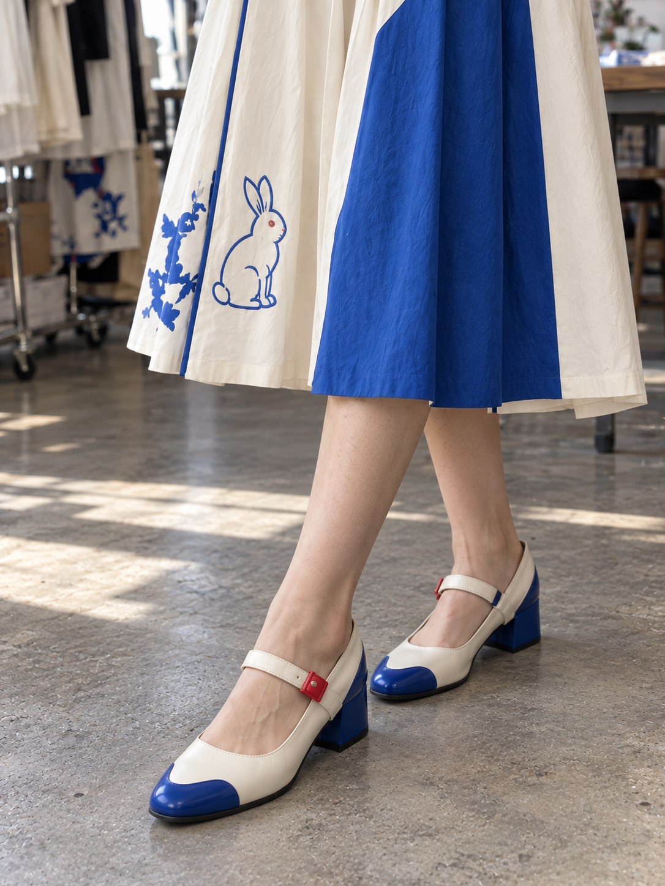

# 007 · 产品包装转译成衣 · Lookbook 与无模特展示

[返回分类索引](../README.md) · [返回首页](../../README.md)

> 把包装的色彩、图形和材质转译为服装结构与配饰，而不只是将商标贴到衣服上。

## 基本信息

| 字段 | 内容 |
| --- | --- |
| 主分类 | 产品与商业视觉 |
| 风格 / 主题标签 | 服装概念 / 包装转译 / 配饰 / Lookbook / 手机花絮 / 无模特展示 |
| 提示词作者 | **DeepBlue深蓝（@DeepBlueX0）**，X 作者，署名由整理者提供 |
| 作者主页 | [x.com/DeepBlueX0](https://x.com/DeepBlueX0)（按所提供账号整理，未独立核验） |
| 原帖链接 | 待补充；收录文本未与原帖逐字核对 |
| 本次主题 | 可口可乐、大白兔奶糖 |
| 工具 / 模型 | Codex 内置图像生成工具；具体底层模型未确认 |
| 收录日期 | 2026-10-12 |
| 已生成 | 可口可乐 1 张四视图拼图；大白兔 4 张连续参考生成 |
| 未测试 | 无模特展示改写版 |
| 图片性质 | 本项目生成的非官方服装概念；不是实际品牌系列或原作者示例 |

展示对象是服装与配饰设计，模特是展示手段，因此主分类为产品与商业视觉；有模特不自动归入人物摄影。

## 收录提示词

两次提供的正文相同，主题分别为【可口可乐】与【大白兔奶糖】。大白兔版本另附 `n=4`，用于要求四张结果。以下用【产品】保留可替换位置，正文保持本次提供的措辞。

```text
【产品】 × 主题成衣设计 × 全套服饰与配饰 × 独立设计师品牌 Lookbook × iPhone拍摄花絮

提取产品包装的标志性色彩、图形、字体与材质特征，将其转译为服装、手袋、鞋履、首饰及其他配饰的造型、纹样与结构设计，形成统一且具有产品辨识度的完整穿搭。具体设计随产品包装变化，保留原产品的视觉识别特征，确保服装与配饰具备合理的结构、真实的穿着效果与实际制作可能。根据服装与配饰的展示需求，自然安排全身、中景、近景及局部特写，合理呈现整体穿搭、单品设计与材质细节。成年女性模特，结合自然的拍摄间隙与人物状态，呈现真实时装拍摄的现场感。
```

原文中“实际制作可能”是生成目标，不意味着图像已经通过打版、材料或生产验证。

## 本次生成结果

### 可口可乐 · 四视图拼图



本次具体化为红白短夹克与中长裙、流线嵌片和拉环式配饰，选择了规整拼图展示。包装曲线在全套单品中重复，主题较易辨认；材质与结构是视觉概念，未验证可生产性。

### 大白兔奶糖 · 四张系列

| 全身穿搭 | 拍摄间隙 |
| --- | --- |
| <a href="images/rabbit-01-full-look.png"></a> | <a href="images/rabbit-02-backstage.png"></a> |

| 包袋与首饰 | 鞋履与裙摆 |
| --- | --- |
| <a href="images/rabbit-03-bag-jewelry.png"></a> | <a href="images/rabbit-04-shoes.png"></a> |

第一张确定设计，后面三张参考前面的结果生成。它们不是四次完全独立随机生成。奶白与钴蓝、红色小扣件、包袋糖纸端部较一致；兔形耳饰实际更像花形，部分蓝色装饰也不像清楚的兔图案，未完全达成原先要求。

## 整理者观察与本项目判断

**整理者观察：**本次效果不如原作者，风格偏正经；怀疑生成系统偏保守，对较大胆画面的表达有限。整理者提出，这条提示词也许更适合帮助服装设计者制作无模特的服装上身展示。

**我的判断：**无模特版本是有价值的扩展，可以减少人物表情与姿态的干扰，更清楚地看版型与单品关系。但它不是这条提示词唯一的价值：包装到服装结构的转译，以及全套配饰统一，也值得保留。

当前未提供原作者效果图、具体模型、包装参考图和生成条件，无法独立比较，也不能确认差异主要来自系统保守。本次提示词改写主动选用了短夹克、中长裙、低跟鞋、克制图案与固定摄影安排，这些选择也会使结果偏规整。对“大白兔”图案、耳饰与材质的理解不足，是另一个更具体、可检查的问题。

若追求更强的时装表达，可直接定义不对称裁片、夸张体积、拼接材料、轮廓比例或戏剧性配饰。设计大胆与画面露肤程度是不同的控制维度；改为无模特能改变展示方式，但不能保证设计自动变大胆。

以上是本项目分析，不是原作者观点或已验证的模型结论。

## 两个明确的使用方向

| 展示方向 | 适合观察 | 优先补充 |
| --- | --- | --- |
| 有模特 Lookbook | 穿搭气氛、人物状态、服装随动作的视觉变化 | 姿态、镜头距离、场景与设计大胆程度 |
| 无模特立体展示 | 轮廓、层次、缝线、面料与单品统一 | 标准展示体、前后视图、结构与材质 |

无模特“上身感”可以采用**隐形人台效果**：衣服呈被人体支撑的立体轮廓，但不出现人物或人台。普通平铺无法表现同样的立体体积。无模特效果是概念展示，也不能代替真实试穿和版型验证。

## 改写版 A · 无模特服装与配饰展示

以下为本项目新增模板，**尚未生成测试**；保留作者原文，不用本版本覆盖原文。

```text
【产品包装或参考图】 × 包装元素转译成衣 × 全套服饰与配饰 × 无模特立体展示 × 独立设计师系列

从包装提取3—5个关键视觉元素：[主色、辅助色、标志图形、字体走势、材质]。
将它们转译为版型、裁片、拼接、纹样、包袋结构、鞋面和首饰细节，避免只把Logo贴在现成衣服上。
设计方向：[日常成衣 / 实验性设计 / 夸张廓形]；大胆程度通过[不对称、体积、材质对比等]明确表达。

服装采用隐形人台效果：呈自然的人体支撑体积与穿着褶皱，不出现人物、皮肤、头、手、脚或可见人台；领口、袖口内部呈合理的衣料结构，不画成随意漂浮。
指定统一的展示体尺寸与比例：[尺寸或体型参照]，作为视觉设定而非真实合身保证。
上衣、下装或连衣裙保持一套一致设计。鞋履与手袋摆放在服装旁边，首饰放在单独细节区，不把首饰悬浮在不存在的皮肤上。

画面1：整套服装正面与配饰全览。
画面2：背面与侧面，保持相同缝线、开合和长度。
画面3：裁片、包袋、鞋履与首饰近景。
画面4：面料厚度、接缝、边缘处理和五金特写。
如只需一张，选择正面全览，其余作为后续图。

使用[自然工作室摄影 / 简洁产品摄影]，柔和真实光线，背景低信息密度。
保持包装辨识度、真实材质与可解释的服装结构；具体可生产性留待打版验证。
不要出现模特，不要生成多余肢体，不要在不同视图随意改变款式。
```

## 改写版 B · 更明确的设计转译

以下是可追加到有模特或无模特版本的条件，**尚未测试**。

```text
优先表达服装设计，而不是模特颜值。
从包装选择[3个核心元素]，分别对应[裁片形状、结构细节、材质]。
用[指定大胆轮廓或结构]作为系列核心，不预设为保守套装。
图案类型：[单个兔形刺绣 / 几何印花 / 包装字标 / 抽象流线]，明确位置、大小和数量。
同一套设计的不同图片保持版型、图案位置、扣件与配饰一致。
若提供包装参考图，以实际图形和色彩为准；没有参考图时不声称精确复刻。
```

## 下一次如何比较

先提供原作者效果图与包装参考，区分“图案准确度”“设计强度”“穿着效果”“拍摄风格”四个目标。保持同一设计，只改变有模特或无模特展示；再单独调整大胆程度。当前没有生成新的无模特图。
