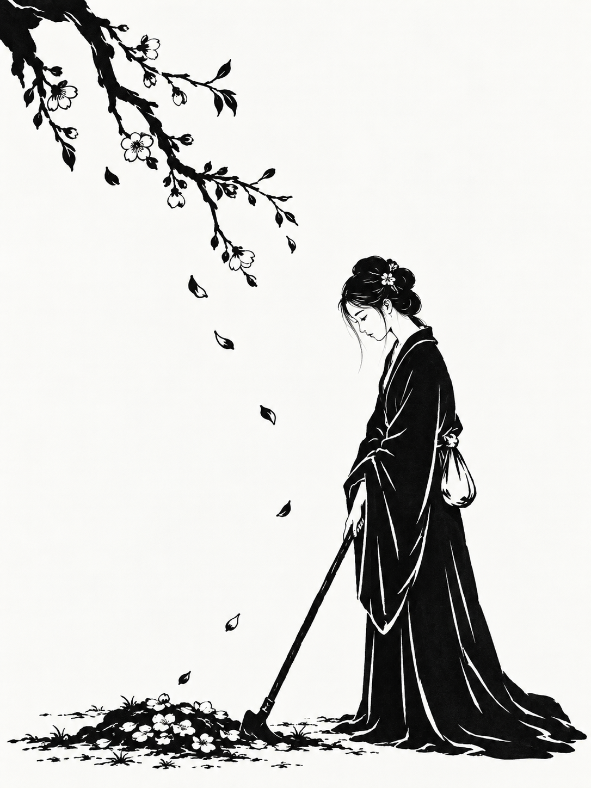

# 009 · 极简黑白木刻人物

[返回分类索引](../README.md) · [返回首页](../../README.md)

> 用坚实黑块、少量刀刻线和留白，为文学人物与篇章建立清楚的视觉意象。

## 基本信息

| 字段 | 内容 |
| --- | --- |
| 主分类 | 插画与人物绘画 |
| 风格 / 主题标签 | 黑白木刻 / 极简块面 / 文学人物 / 书籍插图 / 公众号配图 |
| 提示词作者 | **DeepBlue深蓝（@DeepBlueX0）**，X 作者，署名由整理者提供 |
| 作者主页 | [x.com/DeepBlueX0](https://x.com/DeepBlueX0)（按所提供账号整理，未独立核验） |
| 原帖链接 | 待补充；收录文本未与原帖逐字核对 |
| 收录日期 | 2026-10-12 |
| 示例 | 黛玉葬花、鲁迅执笔，各生成一次 |
| 工具 / 模型 | Codex 内置图像生成工具；具体底层模型未确认 |
| 本次画幅 | 3:4竖幅；原短提示词没有限定比例 |
| 图片性质 | 本项目生成的木刻风格插画，非真实手工雕版印样 |

## 收录提示词

```text
【红楼梦】 × 新兴木刻版画 × 极简黑白块面 × 干净留白
```

本次由整理者指定的替换主题：

```text
【鲁迅】 × 新兴木刻版画 × 极简黑白块面 × 干净留白
```

作者署名由整理者确认。黛玉葬花与鲁迅执笔的具体情节、机位与构图由本次 AI 补充，不声称为原作者文本。

## 示例图片

### 红楼梦 · 黛玉葬花



以花锄斜线、衣袍黑块和左上花枝组织画面，疏落花瓣引导视线。[完整提交文本](prompts/daiyu-submitted.txt)。

### 鲁迅 · 执笔沉思


短发、浓须、长衫与执笔形成识别线索，上方留白、下方黑块建立重心。[完整提交文本](prompts/luxun-submitted.txt)。鲁迅版本重新生成，未以黛玉图作为编辑参考。

## 整理者的应用见解

整理者认为这条适合作为书籍插画与公众号插图。本项目赞同这一使用方向：黑白关系清楚、背景较简洁，容易与正文搭配。这个用途并不要求图像必须带标题；文字排版可以在生成后独立完成。

| 使用位置 | 可补充的条件 |
| --- | --- |
| 书籍内页 / 章节扉页 | 人物与章节情节，版心比例，装订侧留白，细线在最终尺寸下仍可辨 |
| 公众号正文配图 | 适应手机屏幕的主体大小，减少细碎刀痕，保留主要动作与辨识点 |
| 文章封面 | 明确横竖比例与标题区，避免人脸、手和关键道具被裁切 |
| 同一本书的系列 | 固定黑白占比、刀痕粗细、人物比例与纸底色，再替换主题 |

用途与版式建议由本项目补充，尚未实际完成书籍印刷或公众号版式测试。

## 实际体验与不足

| 观察项 | 黛玉示例 | 鲁迅示例 |
| --- | --- | --- |
| 块面和留白 | 衣袍黑块明确，背景干净 | 头发与长衫形成稳定黑块，上方留白较多 |
| 木刻语言 | 衣褶白线清楚，但面部、发饰与花枝偏精细，部分线条更接近线描 | 面部短刀痕与黑白切面较有力量，局部仍有细纹 |
| 人物动作 | 葬花意图可读，花锄与花堆位置明确 | 执笔可辨，但笔与手的连接、笔尖方向仍值得检查 |
| 留白分配 | 上右留白有效，左上枝条略繁 | 下方桌面黑块较重，“至少一半留白”的目标未严格核算 |
| 纯黑白 | 视觉接近黑白，纸底略暖且带纹理 | 同样为近黑白纸本外观，并非验证过的纯双色印刷文件 |

两图均未经过人物肖像准确性、手部结构或印刷工艺核验。不能仅凭风格关键词认为已经符合特定历史流派的全部特征。

我的补充判断：**“极简”与“木刻”要分别控制。** 只写木刻可能产生密集排线，只写极简可能变成光滑剪影。可明确“以完整黑块为主，少量有方向的白色刀痕，局部保留切削边缘”，再根据最终尺寸调整细节。

缩小后若眼睛、胡须、手与道具粘成一块，应简化细碎线条、拉开白色间隙。若计划叠文字，应指定留白的具体位置，而非只写“干净留白”。

## 可复用扩展模板

以下为本项目补充，尚未单独生成验证，不覆盖原文。

```text
【人物或文学篇章】 × 黑白木刻风格 × 极简块面 × 干净留白。
场景与动作：[用一个明确行为表现篇章或人物]。
身份锚点：[2—3个必要的外貌、服饰或道具特征]。
画幅与用途：[书籍内页 / 公众号正文 / 文章封面]，比例[比例]。
人物位于[位置]，在[指定区域]留出连续干净空间用于后续排版。
以完整黑色块面与纸白形成结构，仅在脸、手、衣褶等关键处用少量有方向的刀刻线。
保持刀痕的力度，不用全局细碎排线、均匀噪声或光滑矢量轮廓。
背景只保留[1—2个必要意象]，不添加无关装饰。
细节按手机屏幕或内页缩小后的可读性设计，手与道具连接清楚。
选择[干净纸白 / 轻微纸纹]，不强做旧。
除非另行要求，不生成标题、引文或印章；文字在后期排版。
```

如需要真正用于双色印刷或黑白印刷，应在选图后另行检查分辨率、纸底、灰阶和最细线条，必要时处理成符合输出要求的文件；本次仅保存原始生成图。

## 下一次实验

保持同一人物与动作，先减少面部及背景线条，再按实际文章或内页尺寸检查清晰度。若制作系列，应选定一张作为风格参考，而非让每次重新解释木刻语言。当前没有新增验证图。
