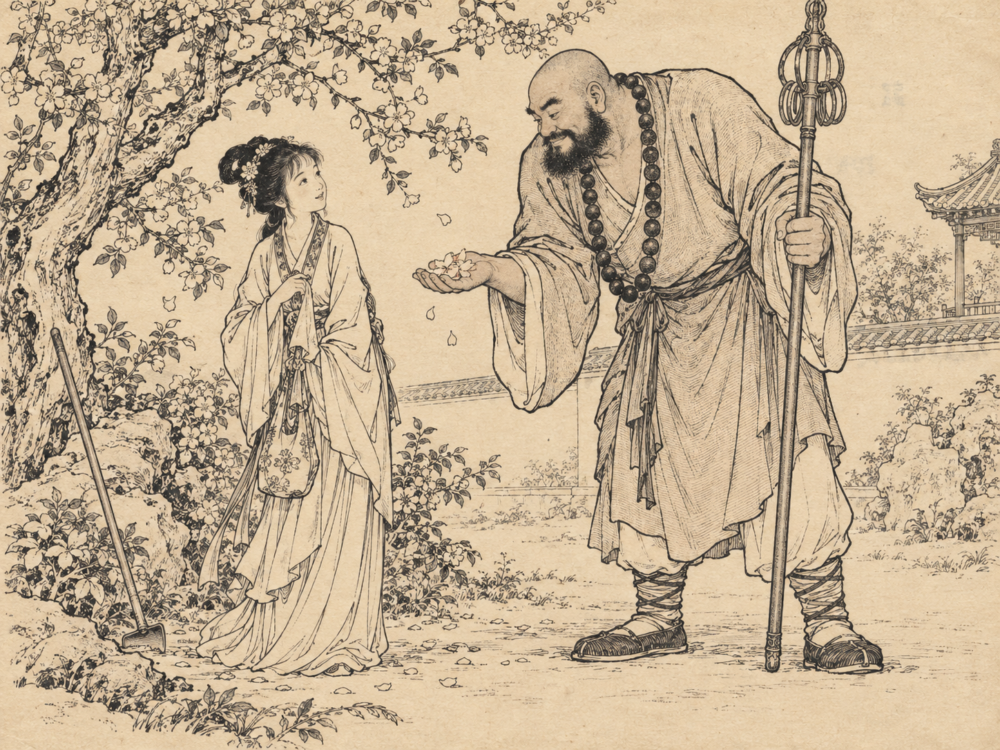

# 010 · 跨作品人物 · 怀旧小人书

[返回分类索引](../README.md) · [返回首页](../../README.md)

> 用怀旧连环画的线描与印刷外观，让不同作品的人物在一个明确的互动中相遇。

## 基本信息

| 字段 | 内容 |
| --- | --- |
| 主分类 | 插画与人物绘画 |
| 风格 / 主题标签 | 连环画 / 小人书 / 跨作品人物 / 怀旧印刷 / 淡彩 / 封面扩展 |
| 提示词作者 | **DeepBlue深蓝（@DeepBlueX0）**，X 作者，署名由整理者提供 |
| 作者主页 | [x.com/DeepBlueX0](https://x.com/DeepBlueX0)（按所提供账号整理，未独立核验） |
| 原帖链接 | 待补充；收录文本未与原帖逐字核对 |
| 本次人物 | 林黛玉、鲁智深，由整理者指定 |
| 收录日期 | 2026-10-12 |
| 工具 / 模型 | Codex 内置图像生成工具；具体底层模型未确认 |
| 生成记录 | 黑白/棕墨版新生成；淡彩版参考前图编辑；首次请求网络失败未产图 |
| 画幅 | 本次4:3横幅，原提示词未限定 |
| 图片性质 | 本项目AI生成，非真实90年代印刷页或原作者示例图 |

## 收录提示词

```text
90年代连环画 × 【林黛玉和鲁智深】 × 泛黄纸张 × 小人书印刷质感
```

人物可替换，具体时代、作品和题材跨度由使用者选择。原短提示词未规定黑白、彩色、互动动作或封面布局。

## 本次示例

### 黑白线描 / 棕墨纸本外观



鲁智深俯身递出花瓣，黛玉抬眼相望。这个互动与花树场景由本次 AI 补充。[实际提交文本](prompts/lineart-submitted.txt)。

### 淡彩小人书外观


使用上一张作参考，增加藕粉、灰青、草绿与赭色，不是四处随意铺满鲜艳颜色。[实际编辑文本](prompts/color-submitted.txt)。

## 整理者的使用见解

人物跨度可以很大，例如**奥特曼与孙悟空**。这不必是同一时代或作品的组合，趣味可以来自性格、体型和行为差异。它适合做插画；补充版式、标题和封面条件后，也可以发展为小人书封皮。细节由使用者填写，并为智能体保留发挥空间。

以上是本项目整理者提出的方向，不归入原作者原文。奥特曼与孙悟空组合及封皮版本目前未生成测试。

## 本项目补充：大跨度人物仍需统一画面语言

- **固定人物识别点。** 每位角色写2—3个关键特征，避免新人物被泛化或两人的特征混在一起。奥特曼宜指定具体角色或版本；孙悟空也宜说明采用哪种形象方向。
- **确定尺度规则。** 例如采用等人尺度的趣味改编，或保留巨大体型并安排可读的互动。不要让模型同时猜体型和关系。
- **给一个共同动作。** 递花、对弈、并肩赶路或互换道具，比只有两个名字更能形成连环画叙事。若要战斗，也应说明动作关系和前后位置。
- **统一为小人书语言。** 即使一个角色来自特摄、另一个来自古典小说，也可以都转为朴素线描与淡彩印刷，避免一半真人摄影、一半现代动漫。
- **保留可发挥区域。** 使用者固定人物、互动和色彩模式；环境与小道具可由智能体选择，但不要喧宾夺主。

这些是提示词设计建议，不代表已经验证的跨角色稳定表现。

## 实际体验与不足

| 观察项 | 本次结果与局限 |
| --- | --- |
| 人物互动 | 递花动作与体型差异清楚，表情较温和；这是趣味改编，不是原著情节 |
| 印刷感 | 泛黄纸面与细线效果明确，但略接近统一复古滤镜；未验证真实年代印刷工艺 |
| 背景密度 | 花枝、衣褶和树皮偏细密，彩色版仍比预期繁，缩小后可能抢人物注意力 |
| 颜色 | 彩色版有粉、青、绿、赭，线稿仍主导；色彩模式最好明确填写 |
| 道具与形象 | 禅杖形态、人物面貌等属于本次视觉改编，未按原著或历史器物核验 |
| 连续性 | 彩色编辑保留主要构图，但不保证所有线条、细节和位置与原图完全一致 |
| 应用 | 当前是单幅内页风格插图，没有生成标题，也未测试完整封皮 |

“泛黄纸张”可以保留，但应限制黄斑、污渍、透印和噪声的强度。书页感觉不应盖住线条。若用于系列，可固定线条粗细与纸底色，减少每张风格漂移。

## 插画扩展模板

以下为本项目补充的待验证模板，不覆盖原文。

```text
90年代连环画 × 【人物A与人物B】 × 泛黄纸张 × 小人书印刷质感。
人物识别点：A[特征]，B[特征]；统一使用传统连环画线描。
尺度关系：[等人尺度改编 / 保留大小差异]。
互动：[一个主要动作]，两人姿态与道具连接自然。
色彩：[黑白线描 / 克制淡彩，择一]。
构图与比例：[比例、位置、景别]，背景只保留必要叙事线索。
纸底轻微泛黄，印墨略不均，不用强污渍、破损和全局颗粒。
线条在缩小后仍清楚；环境和辅助道具可适度发挥。
```

## 小人书封皮扩展模板

本版本是封面设计用途，若形成独立词条应归入“海报与平面设计”；当前作为本插画词条的扩展保存。尚未测试。

```text
怀旧彩色小人书封皮，主题【人物A与人物B】。
使用[竖幅 / 横幅]比例[比例]，封面正视图，不生成整本书的透视照片。
标题准确写作“[书名]”，位于[位置]，与主角面部、手和道具分开。
作者署名：[实际需要的署名，若无则不生成]。
角色使用统一连环画细线与淡彩印刷，核心动作[动作]，明确体型关系。
配色[3—5个颜色]，克制泛黄纸底与轻微印墨不均。
留出清楚的标题区和边缘空间，主要人物不能被裁切。
不要凭空生成真实出版社标志、ISBN、版权页或出版信息。
若文字准确性不稳定，先生成无字封面并保留标题区，再独立排字。
```

下一次可以只替换为跨度大的角色组合，保留同一线条与色彩方向，再单独测试封面排版；避免一次同时修改人物、比例、风格和文字。
