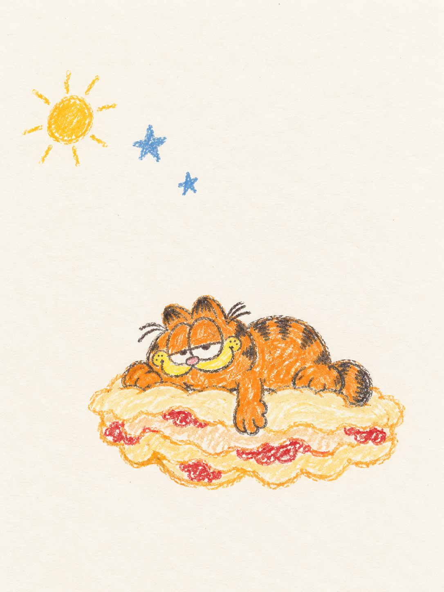

# 011 · 稚拙蜡笔画 · 自由想象

[返回分类索引](../README.md) · [返回首页](../../README.md)

> 用不均匀的蜡笔线条和一个简单的奇想，让熟悉的角色变成轻松的纸上小故事。

## 基本信息

| 字段 | 内容 |
| --- | --- |
| 主分类 | 插画与人物绘画 |
| 风格 / 主题标签 | 蜡笔 / 稚拙手绘 / 自由想象 / 纸张纹理 / 留白 |
| 提示词作者 | **DeepBlue深蓝（@DeepBlueX0）**，X 作者，署名由整理者提供 |
| 作者主页 | [x.com/DeepBlueX0](https://x.com/DeepBlueX0)（按所提供账号整理，未独立核验） |
| 原帖链接 | 待补充；收录文本未与原帖逐字核对 |
| 示例主题 | 加菲猫，躺在千层面云朵上打盹；具体场景由本次 AI 补充 |
| 工具 / 模型 | Codex 内置图像生成工具；具体底层模型未确认 |
| 收录日期 / 次数 | 2026-10-12 / 已生成一次 |
| 本次画幅 | 3:4竖幅；原文未限定比例 |
| 图片性质 | 本项目AI生成，非真实儿童画作或原作者示例图 |

## 收录提示词

```text
【加菲猫】 × 稚拙手绘蜡笔画 × 儿童式自由想象 × 纸张纹理 × 大面积留白
```

角色可以替换。原文没有限定具体动作、故事、颜色或留白位置；下面的分析与扩展属于本项目，不覆盖作者原文。

## 本次效果图



橙色加菲猫与千层面云朵位于下部，左上有小太阳与两颗蓝星。[完整实际提交文本](prompts/submitted.txt)。没有使用参考图片。

## 实际体验与不足

| 观察项 | 一次输出的表现 |
| --- | --- |
| 角色辨识 | 橙色身体、黑条纹、黄色口鼻区和半闭眼让加菲猫较易辨认 |
| 自由想象 | 把爱吃的千层面变成云朵，主题关联明确，画面没有堆入太多故事元素 |
| 蜡笔笔触 | 色块有漏白、断续痕迹与重复涂画，轮廓较不均匀；效果仍较精致完整 |
| 稚拙程度 | 解剖、表情和故事安排较成熟，更接近设计过的童趣插画，而非完全随意的儿童画 |
| 留白 | 上部空间明显，但主体比“小型图案”目标更大；提交文本要求至少65%留白，未测量确认 |
| 纸纹 | 纸底有细纹，蜡笔色块也有明显纹理；两者叠加时需防止变成全局颗粒滤镜 |

“儿童式”在这里指自由、简单、非精密的视觉语言，不是声称画面由儿童实际绘制。

## 本项目的补充见解

我认为这条的关键是**熟悉角色＋一个简单想象**，而不只是加上一层蜡笔噪声。可以把角色喜欢的食物、日常动作或情绪转换为场景，但每张先保留一个主要奇想，让留白承接故事。

- **留几个识别点。** 角色可以画歪、颜色可以涂出边界，但不必同时丢掉条纹、眼神和轮廓。
- **把稚拙落实在线条上。** 指定不闭合轮廓、局部重复描线、压力不均与少量涂出界，比单写“儿童画”更具体。
- **区分纸纹与蜡笔。** 纸纹轻微、贯穿纸底；蜡笔的颗粒断续跟随笔划，密度因压力而变化，避免所有区域同样粗糙。
- **明确留白位置。** 若用于卡片、文章配图或后续加标题，指定人物在下方、左侧或右侧，以及空白区用途；只写“大面积留白”未必适合最终版式。
- **自由发挥需要边界。** 固定角色、主要动作与一个奇想，太阳、星星等辅助小图案可由智能体选择；不让装饰填满空白。

这些是提示词设计判断，尚未分别做对照测试。

## 可复用扩展模板

以下为本项目新增的待验证版本。

```text
【角色或主体】 × 稚拙手绘蜡笔画 × 自由想象 × 轻微纸张纹理 × 大面积留白。
识别点：[2—3个必要特征]。
主要动作：[一个动作]；想象场景：[一个简单奇想]。
角色位于[位置]，整体图案占画面约[比例]，在[区域]保留连续空白。
色彩：[3—5个颜色]，背景以纸底为主，不整页铺色。
线条摇晃、粗细与压力不均，局部不闭合，有漏白、重复涂画和少量出界。
蜡笔颗粒沿笔划变化，不把纸纹与颜料都变成均匀全局噪点。
保留角色表情与辨识度，不做精致矢量轮廓或光滑贴纸。
辅助图案少量，具体形状可适度发挥；不填满留白。
画幅：[比例]，默认无文字、签名或水印。
```

## 下一次实验

先保持加菲猫与千层面云朵场景，只减少轮廓完整度和细节，观察能否更稚拙；再单独缩小主体或调整留白。若使用者希望更精致的童趣插画，则保留当前完整度即可，不必将“越画歪”作为唯一目标。
